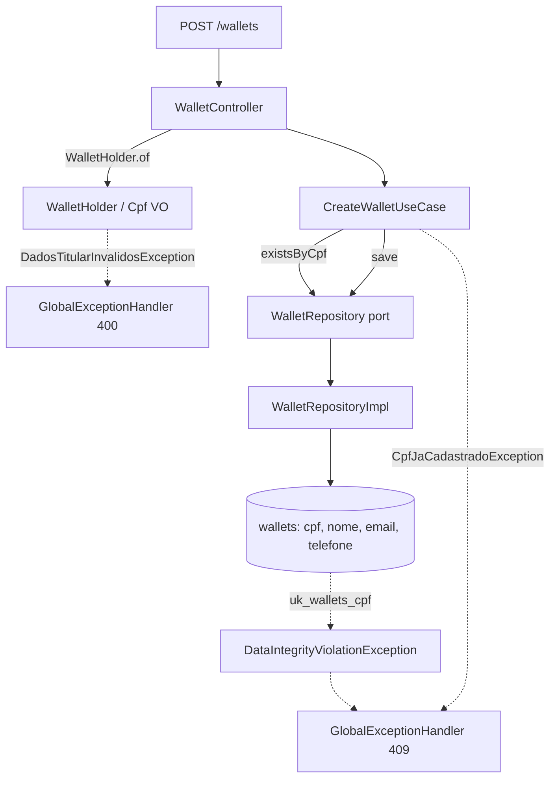

# Wallet Holder Data Design

**Spec**: `.specs/features/wallet-holder-data/spec.md`
**Status**: Draft

---

## Architecture Overview

A feature segue as camadas que o projeto já usa: `domain` (entidades, value objects, portas), `usecase`, `infrastructure` (web, persistência). Os dados do titular viram dois value objects no domínio, `Cpf` e `WalletHolder`. Toda validação e normalização fica neles. O controller chama `WalletHolder.of(...)`, do mesmo modo que hoje chama `Money.of(...)` no depósito. A unicidade tem duas barreiras: um pré-check no caso de uso, que dá o 409 limpo, e um índice único parcial no banco, que fecha a corrida entre requisições concorrentes.



Validação de formato no domínio, e não com Bean Validation no DTO, por uma razão de privacidade: `handleValidationException` loga `ex.getMessage()`, que traz o valor rejeitado (o CPF digitado). O mesmo vale para `handleDataIntegrityViolationException`, cujo log carrega o `Detail: Key (cpf)=(...)` do Postgres. Ver Risks.

---

## Code Reuse Analysis

### Existing Components to Leverage

| Component | Location | How to Use |
| --------- | -------- | ---------- |
| `Money` (value object com factory estática `of`) | `domain/valueobject/Money.java` | Mesmo padrão para `Cpf.of` e `WalletHolder.of` |
| `DomainException` e `ValorInvalidoException` | `domain/exception/` | Base e padrão de factories estáticas para `DadosTitularInvalidosException` e `CpfJaCadastradoException` |
| `PixKey.validateEmail` (regex de e-mail) | `domain/entity/PixKey.java:57` | Reusar o mesmo regex em `WalletHolder` |
| `GlobalExceptionHandler` | `infrastructure/exception/GlobalExceptionHandler.java` | Novos handlers no padrão `ErrorResponse.builder()` |
| `WalletRepositoryImpl.toJpaEntity` e `toDomain` | `infrastructure/persistence/repository/WalletRepositoryImpl.java:45-65` | Mapear os campos do titular |
| `BaseIntegrationTest` | `src/test/.../infrastructure/BaseIntegrationTest.java` | Base do teste de integração da API (Testcontainers + RestAssured) |
| `WalletTest`, `CreateWalletUseCaseTest` | `src/test/.../domain/entity`, `usecase` | Estender com novos casos; os existentes ficam intactos |

### Integration Points

| System | Integration Method |
| ------ | ------------------ |
| PostgreSQL | Migração Flyway `V3__add_wallet_holder_data.sql`; `ddl-auto: validate` exige que a entidade JPA bata com ela |
| Swagger (`WalletControllerApi`) | Documentar o 409 e os novos campos de `CreateWalletRequest` |
| Teste de carga Gatling (`performance-tests`) | Sem mudança: continua enviando só `userId` |

---

## Components

### Cpf (value object)

- **Purpose**: Representa um CPF válido e normalizado, com versão mascarada.
- **Location**: `src/main/java/com/elton/pixservice/domain/valueobject/Cpf.java`
- **Interfaces**:
  - `static Cpf of(String raw)` - aceita 11 dígitos ou `###.###.###-##`; valida dígitos verificadores e rejeita dígitos todos iguais; lança `DadosTitularInvalidosException.cpfInvalido()`
  - `static Cpf restore(String digits)` - reconstrói a partir do banco, sem revalidar
  - `String getDigits()` - 11 dígitos
  - `String masked()` - `***.456.789-**`
  - `toString()` - devolve o valor mascarado, para que log acidental não vaze o CPF
- **Dependencies**: `DadosTitularInvalidosException`
- **Reuses**: padrão de `Money`

### WalletHolder (value object)

- **Purpose**: Agrupa e valida `cpf`, `nome`, `email` e `telefone` opcionais.
- **Location**: `src/main/java/com/elton/pixservice/domain/valueobject/WalletHolder.java`
- **Interfaces**:
  - `static WalletHolder of(String cpf, String nome, String email, String telefone)` - `null` significa ausente; string vazia ou em branco é inválida. Normaliza: nome com trim (2 a 150 caracteres), e-mail com trim e minúsculas (até 254 caracteres, regex de `PixKey`), telefone sem alteração (`^\+[1-9]\d{7,14}$`)
  - `static WalletHolder empty()`
  - `Cpf getCpf()`, `String getNome()`, `String getEmail()`, `String getTelefone()` (todos anuláveis)
  - construtor `@AllArgsConstructor` para reconstituição pelo repositório
  - `@ToString.Exclude` em `nome`, `email` e `telefone`
- **Dependencies**: `Cpf`, `DadosTitularInvalidosException`
- **Reuses**: regex de e-mail de `PixKey`

### DadosTitularInvalidosException e CpfJaCadastradoException

- **Purpose**: Erros de domínio com mensagens fixas, sem o valor do dado.
- **Location**: `domain/exception/`
- **Interfaces**:
  - `DadosTitularInvalidosException.cpfInvalido()` ("Invalid CPF"), `.emailInvalido()` ("Invalid email"), `.telefoneInvalido()` ("Invalid phone"), `.nomeInvalido()` ("Invalid name")
  - `CpfJaCadastradoException()` ("CPF already registered")
- **Dependencies**: `DomainException`
- **Reuses**: padrão de `ChavePixInvalidaException`, mas sem interpolar o valor

### Wallet (entidade, alterada)

- **Purpose**: Ganha o campo `holder`.
- **Location**: `domain/entity/Wallet.java`
- **Interfaces**: `@Builder.Default private WalletHolder holder = WalletHolder.empty();` com `@ToString.Exclude`. Nunca é `null`.
- **Reuses**: a entidade existente; `deposit` e `withdraw` não mudam.

### Persistência

- **Purpose**: Gravar e ler os campos do titular e checar duplicidade.
- **Location**:
  - `src/main/resources/db/migration/V3__add_wallet_holder_data.sql`
  - `WalletJpaEntity` (4 colunas novas, `@ToString.Exclude`)
  - `WalletJpaRepository.existsByCpf(String)`
  - `WalletRepository.existsByCpf(Cpf)` (porta) e `WalletRepositoryImpl` (mapeamento e implementação)
- **Reuses**: `toJpaEntity` e `toDomain` existentes

### CreateWalletUseCase (alterado)

- **Purpose**: Criar a carteira com titular opcional e recusar CPF duplicado.
- **Location**: `usecase/CreateWalletUseCase.java`
- **Interfaces**:
  - `Wallet execute(String userId, WalletHolder holder)` - se `holder.getCpf() != null` e `existsByCpf`, lança `CpfJaCadastradoException`
  - `Wallet execute(String userId)` - mantido, delega com `WalletHolder.empty()`; preserva os testes e mocks atuais
- **Dependencies**: `WalletRepository`
- **Reuses**: o fluxo atual de `save`. O log continua sem CPF, e-mail ou telefone.

### Web: DTOs e controller

- **Purpose**: Receber os campos novos e devolver o titular na criação.
- **Location**: `infrastructure/web/`
- **Interfaces**:
  - `StrictStringDeserializer` (novo, `dto/`) - rejeita número ou booleano onde se espera string; usado nos 4 campos de `CreateWalletRequest`
  - `CreateWalletRequest` - 4 campos novos com `@ApiModelProperty`; `@ToString.Exclude` nos 4; construtor `CreateWalletRequest(String userId)` explícito, porque ~30 chamadas nos testes usam o construtor de 1 argumento
  - `WalletResponse` - `cpf` (mascarado), `nome`, `email` e `telefone` com `@JsonInclude(NON_NULL)` por campo; depósito e saque não os preenchem
  - `WalletController.createWallet` - `WalletHolder.of(...)`, `execute(userId, holder)`, resposta com `holder.getCpf().masked()`
  - `WalletControllerApi` - `@ApiResponse` 409 e descrição
- **Reuses**: o mapeamento atual com builder

### GlobalExceptionHandler (alterado)

- **Purpose**: Mapear erros novos sem logar PII.
- **Location**: `infrastructure/exception/GlobalExceptionHandler.java`
- **Interfaces**:
  - handler de `DadosTitularInvalidosException` (400, log `warn` com a mensagem fixa)
  - handler de `CpfJaCadastradoException` (409)
  - em `handleDataIntegrityViolationException`: se a mensagem contém `uk_wallets_cpf`, 409 "CPF already registered" e log fixo, sem `ex.getMessage()` nem stack trace (o `Detail` do Postgres traz o CPF)
  - handler de `HttpMessageNotReadableException` (400, mensagem fixa "Malformed request body", log sem `ex.getMessage()`)

---

## Data Models

### Migração `V3__add_wallet_holder_data.sql`

```sql
ALTER TABLE wallets
    ADD COLUMN cpf      VARCHAR(11),
    ADD COLUMN nome     VARCHAR(150),
    ADD COLUMN email    VARCHAR(254),
    ADD COLUMN telefone VARCHAR(16);

ALTER TABLE wallets
    ADD CONSTRAINT ck_wallets_cpf_format CHECK (cpf IS NULL OR cpf ~ '^[0-9]{11}$');

CREATE UNIQUE INDEX uk_wallets_cpf ON wallets (cpf) WHERE cpf IS NOT NULL;
```

Colunas nullable: as carteiras existentes ficam intactas e não há backfill. O índice é parcial, então várias carteiras sem CPF coexistem (WHOLD-12). O `CHECK` é a última barreira contra CPF fora do formato.

### WalletJpaEntity (acréscimo)

```java
@Column(length = 11)  private String cpf;
@Column(length = 150) private String nome;
@Column(length = 254) private String email;
@Column(length = 16)  private String telefone;
```

**Relationships**: nenhuma nova. `pix_keys`, `ledger_entries` e `pix_transfers` referenciam `wallets(id)` e não mudam. A view materializada `mv_wallet_stats` seleciona colunas explícitas, então `ADD COLUMN` não a afeta.

---

## Error Handling Strategy

| Error Scenario | Handling | User Impact |
| -------------- | -------- | ----------- |
| CPF, e-mail, telefone ou nome inválido ou em branco | `DadosTitularInvalidosException` no controller, handler 400 | 400 "Invalid CPF" / "Invalid email" / "Invalid phone" / "Invalid name" |
| CPF já existe (pré-check) | `CpfJaCadastradoException`, handler 409 | 409 "CPF already registered" |
| CPF duplicado em corrida | `uk_wallets_cpf` dispara `DataIntegrityViolationException`, branch específico no handler | 409 "CPF already registered"; log sem CPF |
| Campo do titular com tipo errado no JSON | `StrictStringDeserializer` falha, handler de `HttpMessageNotReadableException` | 400 "Malformed request body" |
| `userId` ausente ou em branco | `@NotBlank` existente, inalterado | 400 "Validation Failed" / "User ID is required" |
| Falha na gravação | `@Transactional` do caso de uso desfaz a inserção | Sem carteira parcial |

---

## Risks & Concerns

| Concern | Location (file:line) | Impact | Mitigation |
| ------- | -------------------- | ------ | ---------- |
| Handler de integridade loga `ex.getMessage()` em ERROR com stack trace; o Postgres inclui `Key (cpf)=(...)` | `GlobalExceptionHandler.java:250` | CPF completo nos logs, violando WHOLD-18 | Branch de `uk_wallets_cpf` antes do log genérico, log fixo; coberto por teste unitário do handler |
| Handler de validação loga `ex.getMessage()` com o valor rejeitado | `GlobalExceptionHandler.java:230` | CPF vazaria se a validação do formato fosse Bean Validation no DTO | Validar formato só no domínio; AD-001 no `STATE.md` |
| `@Data` gera `toString` com todos os campos em `Wallet`, `WalletJpaEntity` e `CreateWalletRequest` | `Wallet.java:20`, `WalletJpaEntity.java:14`, `CreateWalletRequest.java:11` | Qualquer `log.info("{}", obj)` futuro vaza PII | `@ToString.Exclude` nos campos do titular; `Cpf.toString()` mascarado; teste que afirma que `toString` não contém o CPF |
| `HttpMessageNotReadableException` não tem handler e cai no genérico (500) | `GlobalExceptionHandler.java:270` | JSON malformado ou com tipo errado retorna 500; o edge case da spec exige 400 | Novo handler (T11). Muda 500 para 400 em todos os endpoints, o que é mais correto; nenhum teste atual espera 500 |
| Jackson converte número em String por padrão | `CreateWalletRequest` | `"cpf": 12345678909` seria aceito | `StrictStringDeserializer` nos 4 campos, apenas neste DTO |
| Todos os testes HTTP existentes estão `@Disabled` (`WalletControllerRestAssuredTest`, `WalletControllerIntegrationTest`, `PixControllerRestAssuredTest`, `PixTransferEndToEndTest`) | `src/test/.../controller/`, `PixTransferEndToEndTest.java` | O critério "suíte existente passa" é vazio para a camada HTTP, e `BaseIntegrationTest` nunca foi provado verde | Teste novo e habilitado `WalletHolderApiTest` cobre `userId` só, criação completa, 409 e concorrência; testes de controller com MockMvc standalone rodam sem Docker. Reabilitar os antigos fica fora de escopo; recomendo uma feature própria |
| Docker não está rodando nesta máquina e o Testcontainers precisa dele | `application-test.yml:3` | Testes de repositório e de API não executam localmente sem Docker Desktop | Marcar com `@Tag("docker")`; gate Quick exclui a tag; gate Full exige Docker; o CI (`ubuntu-latest`) tem Docker |
| `mvnw.cmd` existe, mas falta `.mvn/wrapper`; o CI usa `./mvnw` | `.github/workflows/ci.yml:33` | O CI pode estar quebrado, e localmente não há `mvn` no PATH | Gates usam o Maven embutido do IntelliJ; registrar como pendência, sem corrigir aqui |
| `BaseIntegrationTest` é `@Transactional`, mas o servidor roda em outra thread e faz commit | `BaseIntegrationTest.java:24` | Dados persistem entre testes; um CPF fixo colidiria | Cada teste gera um CPF válido aleatório |
| `RegisterPixKeyUseCase` loga o valor completo da chave Pix, que pode ser um CPF | `RegisterPixKeyUseCase.java:24` | Vazamento de CPF por outra feature, fora do escopo | Não alterar aqui; os testes desta feature não registram chave Pix; registrar como follow-up |
| Trigger `prevent_noop_wallet_update` cancela UPDATE sem mudança de saldo ou versão | `V2__database_optimizations.sql:100-113` | Não afeta a criação (INSERT), mas bloquearia a futura edição de dados do titular | Fora de escopo; anotado para a feature de atualização |

---

## Tech Decisions (only non-obvious ones)

| Decision | Choice | Rationale |
| -------- | ------ | --------- |
| Onde validar | No domínio, chamado pelo controller | Evita o vazamento via handler de Bean Validation; segue o padrão `Money.of` do depósito |
| Estrutura no `Wallet` | Um objeto `holder` nunca nulo | Mantém `Wallet` com um campo novo e dá um lugar único às regras do titular |
| Unicidade | Pré-check mais índice único parcial | O pré-check dá o 409 limpo e testável sem Docker; o índice garante a corrida (WHOLD-11) |
| Preservar `execute(String)` e `CreateWalletRequest(String)` | Manter como sobrecarga e construtor extra | ~30 chamadas nos testes e o teste de carga dependem deles |
| Testes sem Docker | `MockMvcBuilders.standaloneSetup` com `GlobalExceptionHandler` | Cobre controller e handlers sem subir contexto nem Testcontainers |
| Captura de logs nos testes | `ListAppender` do Logback | O RestAssured imprime no `System.out`, o que poluiria uma captura de stdout |

> **Project-level decisions:** a regra de PII vira o `AD-001` em `.specs/STATE.md`.
