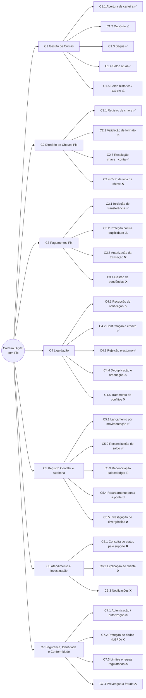
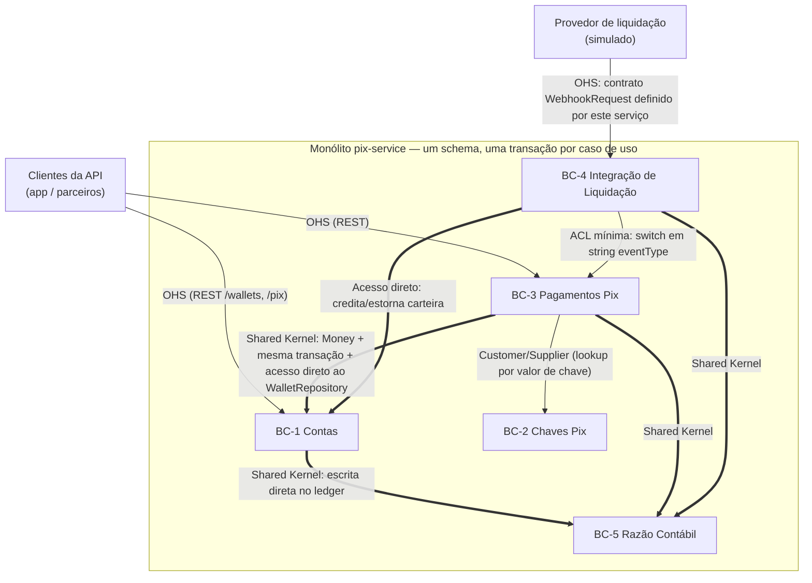
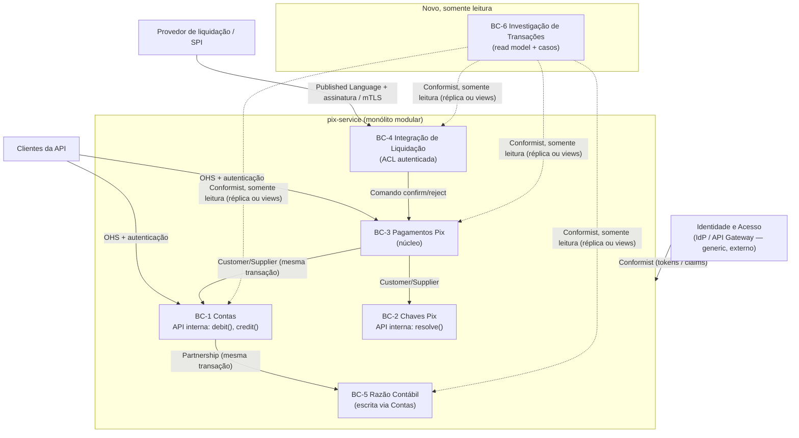

# 02 — Mapa de Domínios e Capacidades

> **Objetivo:** identificar domínios, subdomínios, bounded contexts, agregados e capacidades de negócio do Pix Service, **separando o conceito de negócio da estrutura técnica do código**.
> **Base de evidências:** [01-arquitetura-atual.md](01-arquitetura-atual.md). Os IDs de regras (RN-xx), funcionalidades (Fx) e achados (AC-xx) referem-se a esse documento.
> **Legenda:** **[FATO]** verificado no repositório · **[HIPÓTESE]** inferência não verificada por execução · **[REF. EXTERNA]** conhecimento externo ao repositório · **[RECOMENDAÇÃO]** proposta do autor.

---

## 1. Princípios aplicados

1. **Controller ≠ domínio.** O `WalletController` hospeda dois contextos (Contas e Chaves Pix), e o `PixController` hospeda dois (Pagamentos e Integração de Liquidação). Ver §8.
2. **Tabela ≠ agregado.** As tabelas `idempotency_keys` e `webhook_events` são mecanismos técnicos de confiabilidade. Não são conceitos de negócio autônomos.
3. **Capacidade = o que o negócio faz**, independentemente de como está implementado. Capacidades ausentes também são mapeadas, porque são relevantes para a análise de agentes (doc 03), mas são marcadas como **Ausente**.
4. **Limites transacionais reais orientam os limites de contexto.** Onde o código exige atomicidade, a separação física não é recomendada sem saga ou outbox (§7).

---

## 2. Domínio e subdomínios

**Domínio:** *Carteira digital com pagamentos instantâneos Pix.*

| Subdomínio | Tipo estratégico | Justificativa | Implementação atual |
|---|---|---|---|
| **Pagamentos Pix** (iniciação, ciclo de vida da transferência) | **Core** | É a razão de existir do produto. A correção (exactly-once, máquina de estados) é o diferencial. | [FATO] F7, F10; [TransferPixUseCase.java](../../src/main/java/com/elton/pixservice/usecase/TransferPixUseCase.java) |
| **Liquidação** (confirmação, rejeição e estorno a partir de eventos externos) | **Core** (acoplado a Pagamentos) | Fecha o ciclo do pagamento. Erros aqui criam ou destroem saldo. | [FATO] F8, F9, F11; [ProcessWebhookUseCase.java](../../src/main/java/com/elton/pixservice/usecase/ProcessWebhookUseCase.java) |
| **Contas e Saldos** | Supporting | Necessário, mas não diferenciador. As regras são simples (RN-03 a RN-06). | [FATO] F1, F3, F4, F5; [Wallet.java](../../src/main/java/com/elton/pixservice/domain/entity/Wallet.java) |
| **Diretório de Chaves Pix** | Supporting | Resolve um identificador amigável para a conta. No arranjo real, quem faz isso é o DICT/BCB. | [FATO] F2; [PixKey.java](../../src/main/java/com/elton/pixservice/domain/entity/PixKey.java) |
| **Razão Contábil (Ledger) e Auditoria** | Supporting (criticidade alta) | Base de auditoria e reconstituição. Não diferencia o produto, mas é obrigatório para confiança. | [FATO] F6, F12; [LedgerEntry.java](../../src/main/java/com/elton/pixservice/domain/entity/LedgerEntry.java) |
| **Atendimento e Investigação de Transações** | Supporting | Explica ao cliente e à operação o que aconteceu com uma transação. | [FATO] **Ausente.** Existe só SQL manual ([USEFUL_QUERIES.sql#L209](../../uteis/USEFUL_QUERIES.sql#L209)). |
| **Prevenção a Fraude, Limites e Conformidade** | Supporting (regulatório) | Exigências do arranjo Pix [REF. EXTERNA]. | [FATO] **Ausente.** |
| **Identidade e Acesso** | Generic | Comprável ou terceirizável (IdP, API Gateway). | [FATO] **Ausente** (AC-02). O diagrama-alvo o posiciona no API Gateway. |
| **Observabilidade e Operação** | Generic (técnico) | Não é domínio de negócio. | [FATO] Parcial (Actuator, Prometheus). |

**[FATO]** A **idempotência** não é um subdomínio. É um mecanismo técnico interno de Pagamentos (RN-13) e de Liquidação (RN-22).

---

## 3. Capability Map

### 3.1 Visão hierárquica

Legenda: ✅ implementada · ⚠️ parcial · 🔧 apenas manual (SQL avulso) · ❌ ausente.

### 3.2 Detalhamento das capacidades

| ID | Capacidade | Status | Regras e funcionalidades | Lacuna principal | Evidência |
|---|---|---|---|---|---|
| C1.1 | Abertura de carteira | ✅ | F1, RN-06 | `userId` é texto livre, sem identidade | [CreateWalletUseCase.java#L20-L34](../../src/main/java/com/elton/pixservice/usecase/CreateWalletUseCase.java#L20-L34) |
| C1.2 | Depósito | ⚠️ | F3, RN-03 | Sem origem de fundos (AC-04) | [DepositUseCase.java#L22-L44](../../src/main/java/com/elton/pixservice/usecase/DepositUseCase.java#L22-L44) |
| C1.3 | Saque | ✅ | F4, RN-04, RN-05 | Sem destino do saque | [WithdrawUseCase.java#L23-L45](../../src/main/java/com/elton/pixservice/usecase/WithdrawUseCase.java#L23-L45) |
| C1.4 | Saldo atual | ✅ | F5 | — | [GetBalanceUseCase.java#L26-L34](../../src/main/java/com/elton/pixservice/usecase/GetBalanceUseCase.java#L26-L34) |
| C1.5 | Saldo histórico / extrato | ⚠️ | F6, RN-26 | Retorna só o saldo; não há extrato (lista de lançamentos) | [GetBalanceUseCase.java#L36-L56](../../src/main/java/com/elton/pixservice/usecase/GetBalanceUseCase.java#L36-L56) |
| C2.1 | Registro de chave | ✅ | F2, RN-07, RN-08 | Sem prova de posse | [RegisterPixKeyUseCase.java#L22-L49](../../src/main/java/com/elton/pixservice/usecase/RegisterPixKeyUseCase.java#L22-L49) |
| C2.2 | Validação de formato | ⚠️ | RN-09 a RN-12 | CPF sem dígito verificador; sem normalização (AC-14) | [PixKey.java#L26-L73](../../src/main/java/com/elton/pixservice/domain/entity/PixKey.java#L26-L73) |
| C2.3 | Resolução de chave | ✅ | RN-14 | Local, sem DICT | [TransferPixUseCase.java#L47-L50](../../src/main/java/com/elton/pixservice/usecase/TransferPixUseCase.java#L47-L50) |
| C2.4 | Ciclo de vida da chave | ❌ | — | Sem exclusão, portabilidade ou reivindicação | — |
| C3.1 | Iniciação de transferência | ✅ | F7, RN-14 a RN-18 | Sem verificação de titularidade (AC-02) | [TransferPixUseCase.java#L33-L102](../../src/main/java/com/elton/pixservice/usecase/TransferPixUseCase.java#L33-L102) |
| C3.2 | Proteção contra duplicidade | ⚠️ | F10, RN-13 | Não reproduz a resposta original (AC-09) | [TransferPixUseCase.java#L39-L44](../../src/main/java/com/elton/pixservice/usecase/TransferPixUseCase.java#L39-L44) |
| C3.3 | Autorização da transação | ❌ | — | Sem limites, antifraude ou autenticação forte | — |
| C3.4 | Gestão de pendências | ❌ | — | `PENDING` eterno (AC-05) | — |
| C4.1 | Recepção de notificação | ⚠️ | F8, F9 | Sem autenticação (AC-03); `occurredAt` descartado | [PixController.java#L59-L71](../../src/main/java/com/elton/pixservice/infrastructure/web/controller/PixController.java#L59-L71) |
| C4.2 | Confirmação e crédito | ✅ | RN-20 | — | [ProcessWebhookUseCase.java#L57-L85](../../src/main/java/com/elton/pixservice/usecase/ProcessWebhookUseCase.java#L57-L85) |
| C4.3 | Rejeição e estorno | ✅ | RN-21 | Estorno tipado como `DEPOSIT` | [ProcessWebhookUseCase.java#L87-L115](../../src/main/java/com/elton/pixservice/usecase/ProcessWebhookUseCase.java#L87-L115) |
| C4.4 | Deduplicação e ordenação | ⚠️ | F11, RN-22 | Sem ordenação por `occurredAt`; 409 em corrida | [ProcessWebhookUseCase.java#L31-L34](../../src/main/java/com/elton/pixservice/usecase/ProcessWebhookUseCase.java#L31-L34) |
| C4.5 | Tratamento de conflitos de liquidação | ❌ | RN-23 | Conflito descartado com log (AC-06) | [ProcessWebhookUseCase.java#L58-L62](../../src/main/java/com/elton/pixservice/usecase/ProcessWebhookUseCase.java#L58-L62) |
| C5.1 | Lançamento por movimentação | ✅ | RN-25, RN-27 | Imutável só por convenção (AC-13) | [LedgerEntry.java](../../src/main/java/com/elton/pixservice/domain/entity/LedgerEntry.java) |
| C5.2 | Reconstituição de saldo | ✅ | F6, RN-26 | O(n) em memória | [GetBalanceUseCase.java#L46-L51](../../src/main/java/com/elton/pixservice/usecase/GetBalanceUseCase.java#L46-L51) |
| C5.3 | Reconciliação saldo × ledger | 🔧 | F12 | Só SQL avulso, sem job nem alerta | [USEFUL_QUERIES.sql#L68](../../uteis/USEFUL_QUERIES.sql#L68) |
| C5.4 | Rastreamento ponta a ponta | 🔧 | F12 | Só SQL avulso | [USEFUL_QUERIES.sql#L209](../../uteis/USEFUL_QUERIES.sql#L209) |
| C5.5 | Investigação de divergências | ❌ | — | Sem processo, sem registro de casos | — |
| C6.x | Atendimento e investigação | ❌ | — | Inexistente | — |
| C7.x | Segurança e conformidade | ❌ | — | Inexistente (AC-02, AC-03, AC-07) | — |

---

## 4. Bounded Contexts

O código atual é **um único contexto físico** (um módulo e um schema). A tabela abaixo propõe os **contextos lógicos** que emergem do modelo e da linguagem do código. **[RECOMENDAÇÃO]** Materializá-los como **módulos de um monólito modular**, e não como microsserviços (ver §7).

| BC | Responsabilidade | Linguagem ubíqua (termos do código) | Agregados | Artefatos de código atuais |
|---|---|---|---|---|
| **BC-1 Contas** | Manter o saldo e garantir que ele nunca fique negativo | carteira (`Wallet`), saldo (`balance`), depósito, saque, titular (`userId`) | `Wallet` | `Wallet`, `CreateWallet/Deposit/Withdraw/GetBalanceUseCase` (parcial), `WalletRepository*`, `wallets` |
| **BC-2 Chaves Pix** | Registrar, validar e resolver chaves | chave (`PixKey`), tipo (`PixKeyType`), EVP, valor da chave | `PixKey` | `PixKey`, `RegisterPixKeyUseCase`, `PixKeyRepository*`, `pix_keys` |
| **BC-3 Pagamentos Pix** | Iniciar transferências e governar seu ciclo de vida | transferência (`PixTransfer`), `endToEndId`, `PENDING/CONFIRMED/REJECTED`, `Idempotency-Key` | `PixTransfer` | `PixTransfer`, `TransferStatus`, `TransferPixUseCase`, `PixTransferRepository*`, `IdempotencyRepository*`, `pix_transfers`, `idempotency_keys` |
| **BC-4 Integração de Liquidação** (ACL) | Traduzir eventos externos em comandos de domínio e deduplicá-los | evento (`eventId`), `eventType`, `occurredAt` | — (só o registro `WebhookEvent`) | `ProcessWebhookUseCase` (parcial), `WebhookRequest`, `WebhookEventRepository*`, `webhook_events` |
| **BC-5 Razão Contábil** | Registrar de forma append-only toda movimentação e reconstituir posições | lançamento (`LedgerEntry`), tipo (`LedgerEntryType`), valor assinado | `LedgerEntry` | `LedgerEntry`, `LedgerEntryRepository*`, `GetBalanceUseCase.getHistoricalBalance`, `ledger_entries` |
| *BC-6 Investigação de Transações* | *(proposto)* Explicar e investigar o estado de transações e divergências | caso, anomalia, linha do tempo, evidência | `InvestigationCase` (proposto) | **Inexistente.** Base em [USEFUL_QUERIES.sql](../../uteis/USEFUL_QUERIES.sql) |

**[FATO]** A linguagem ubíqua mistura idiomas: as entidades estão em inglês (`Wallet`, `PixTransfer`) e as exceções em português (`SaldoInsuficienteException`, `ChavePixJaRegistradaException`). O risco é baixo, mas vale padronizar o glossário.

---

## 5. Agregados, entidades e invariantes

| Agregado (raiz) | Invariantes protegidas | Onde a invariante é garantida | Consistência | Observações |
|---|---|---|---|---|
| `Wallet` | Saldo ≥ 0 (RN-05); valores > 0 (RN-03, RN-04) | Entidade ([Wallet.java#L32-L47](../../src/main/java/com/elton/pixservice/domain/entity/Wallet.java#L32-L47)) e lock pessimista + `@Version` | Forte (linha única) | Setters públicos permitem burlar (AC-15) |
| `PixTransfer` | Transições válidas (RN-19) | Entidade ([PixTransfer.java#L30-L48](../../src/main/java/com/elton/pixservice/domain/entity/PixTransfer.java#L30-L48)) e enum | Forte (lock na transferência) | Referencia carteiras **por ID**, o que é um bom desenho |
| `PixKey` | Formato (RN-09 a RN-12); unicidade global (RN-07) | Formato: entidade. Unicidade: **constraint do banco**, porque é uma validação baseada em conjunto, fora do agregado | Forte | Sem normalização (AC-14) |
| `LedgerEntry` | Imutabilidade; sinal por tipo (RN-27) | Convenção (sem método de update) | Append-only | Imutabilidade não garantida no banco (AC-13) |

### Invariantes entre agregados (não encapsuladas)

| Invariante | Agregados envolvidos | Como é mantida hoje | Verificação automática? |
|---|---|---|---|
| **INV-1** `wallet.balance = Σ ledger assinado da carteira` | `Wallet` ↔ `LedgerEntry` | Convenção: todo caso de uso escreve ambos na mesma transação (RN-25) | **Não.** Só existe SQL manual ([USEFUL_QUERIES.sql#L68](../../uteis/USEFUL_QUERIES.sql#L68)) |
| **INV-2** Conservação: `Σ saldos + Σ transferências PENDING = Σ DEPOSIT sem endToEndId − Σ WITHDRAW` | `Wallet`, `PixTransfer`, `LedgerEntry` | Consequência das regras RN-17, RN-20 e RN-21 | **Não.** Invariante **[HIPÓTESE]** derivada das regras e não codificada. Estornos são `DEPOSIT` **com** `endToEndId`, o que permite distingui-los. |
| **INV-3** Toda transferência terminal tem exatamente 1 lançamento de débito e exatamente 1 de crédito ou estorno | `PixTransfer` ↔ `LedgerEntry` | Convenção | **Não** |
| **INV-4** Uma transferência `PENDING` deve ser resolvida em até X minutos | `PixTransfer` | **Inexistente** (AC-05) | **Não** |

**Implicação para a etapa 3 [RECOMENDAÇÃO]:** INV-1 a INV-4 são verificáveis com **regras determinísticas** (SQL ou jobs). A *detecção* de violações não precisa de IA. O que hoje é manual e não estruturado é a *investigação* da causa raiz quando uma violação ocorre.

---

## 6. Context Map

### 6.1 Como está (de facto)

**[FATO]** Todos os relacionamentos internos são chamadas diretas a repositórios dentro da mesma transação Spring. Não há interfaces de contexto, eventos de domínio ou anticorrupção entre BC-1, BC-3 e BC-5.

### 6.2 Recomendado (monólito modular)

**[RECOMENDAÇÃO]** O BC-6 é o único contexto novo sugerido. Ele é **somente leitura** em relação aos demais e não participa de nenhuma transação de escrita. É o candidato natural a hospedar capacidades de IA (doc 03).

---

## 7. Responsabilidades e limites transacionais

| Fronteira | Consistência exigida | Situação atual | Recomendação |
|---|---|---|---|
| Pagamentos ↔ Contas (débito na iniciação) | **Forte.** O débito e a criação da transferência são atômicos. | [FATO] Mesma transação ([TransferPixUseCase.java#L33](../../src/main/java/com/elton/pixservice/usecase/TransferPixUseCase.java#L33)) | Manter no mesmo deployable |
| Liquidação ↔ Pagamentos ↔ Contas (crédito/estorno) | **Forte.** Transição de estado e crédito são atômicos. | [FATO] Mesma transação ([ProcessWebhookUseCase.java#L26](../../src/main/java/com/elton/pixservice/usecase/ProcessWebhookUseCase.java#L26)) | Manter. Adicionar autenticação no BC-4. |
| Contas ↔ Razão | **Forte** (INV-1) | [FATO] Mesma transação (RN-25) | Manter e adicionar verificação contínua de INV-1 |
| Pagamentos ↔ Chaves | Leitura consistente no momento da iniciação | [FATO] Leitura na mesma transação, sem lock | Adequado |
| Investigação ↔ todos | **Eventual** (é aceitável ler de réplica) | Inexistente | Somente leitura, com snapshot timestamp em toda resposta |

**Conclusão [RECOMENDAÇÃO]:** dividir BC-1, BC-3, BC-4 e BC-5 em microsserviços **pioraria** a consistência e exigiria sagas compensatórias para um fluxo que hoje é ACID. O ganho de escala não está demonstrado: os números de carga do README (44 req/s) não são verificáveis no repositório (AC-11). A modularização deve ser **lógica**.

---

## 8. Mapeamento técnico → negócio

Este mapeamento mostra por que artefatos técnicos não devem ser tratados como domínios:

| Artefato técnico | Contextos de negócio que hospeda | Observação |
|---|---|---|
| `WalletController` (`/wallets`) | BC-1 Contas **e** BC-2 Chaves Pix | O registro de chave está sob `/wallets/{id}/pix-keys` ([WalletController.java#L52](../../src/main/java/com/elton/pixservice/infrastructure/web/controller/WalletController.java#L52)) |
| `PixController` (`/pix`) | BC-3 Pagamentos **e** BC-4 Liquidação | `/pix/webhook` é integração e não uma API de cliente ([PixController.java#L59](../../src/main/java/com/elton/pixservice/infrastructure/web/controller/PixController.java#L59)) |
| `GetBalanceUseCase` | BC-1 (saldo atual) **e** BC-5 (saldo histórico via ledger) | Duas fontes de verdade distintas ([GetBalanceUseCase.java#L26-L56](../../src/main/java/com/elton/pixservice/usecase/GetBalanceUseCase.java#L26-L56)) |
| `ProcessWebhookUseCase` | BC-4 (deduplicação), BC-3 (transição), BC-1 (crédito) e BC-5 (lançamento) | Caso de uso "orquestrador" que concentra 4 contextos |
| `idempotency_keys` | Mecanismo do BC-3 | Não é domínio |
| `webhook_events` | Mecanismo do BC-4 | Não é domínio |
| `GlobalExceptionHandler` | Transversal (técnico) | Não é domínio |
| `mv_wallet_stats`, `run_maintenance()` | Operação de plataforma | Não é domínio ([V2#L135-L185](../../src/main/resources/db/migration/V2__database_optimizations.sql#L135-L185)) |
| `uteis/USEFUL_QUERIES.sql` | C5.3, C5.4 (capacidades manuais de auditoria) | É a semente do BC-6 |

---

## 9. Lacunas de capacidade relevantes para a análise de IA

| Lacuna | Natureza do problema | Tipo de solução adequada (preliminar) |
|---|---|---|
| C3.3 Autorização, limites e antifraude | Decisão em tempo real, regulada, com custo de erro alto | Regras determinísticas + modelo estatístico, **não** LLM no caminho crítico |
| C3.4 Gestão de pendências | Regra temporal clara (timeout) | Job determinístico |
| C4.5 Conflitos de liquidação | Detecção clara; causa raiz exige correlacionar evidências | Detecção determinística; **investigação candidata a IA** |
| C5.3 / C5.4 Reconciliação e rastreamento | Fórmulas conhecidas (INV-1 a INV-3) | Job e endpoints determinísticos |
| C5.5 Investigação de divergências | Correlação de fontes heterogêneas, hipóteses, narrativa | **Candidata a IA** (assistiva, somente leitura) |
| C6.1 / C6.2 Atendimento | Tradução de estado técnico em explicação para pessoas | **Candidata a IA** (assistiva, somente leitura) |
| C7.x Segurança e conformidade | Controles obrigatórios e auditáveis | Determinístico, **não** IA |

O detalhamento e a classificação final estão em [03-analise-critica-agentes.md](03-analise-critica-agentes.md).
