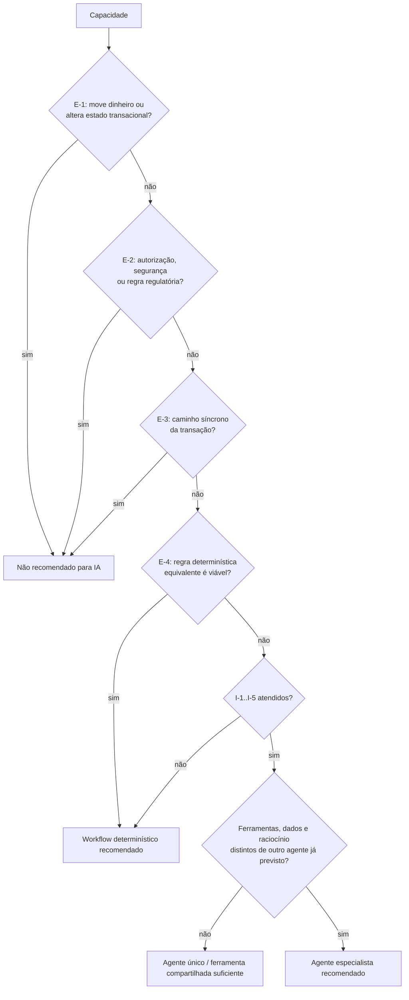

# 03 — Análise Crítica de Agentes Especialistas

> **Objetivo:** decidir, capacidade por capacidade, se um agente de IA (LLM com ferramentas) agrega valor comprovável, ou se lógica determinística, APIs tradicionais ou nenhuma mudança são a escolha correta.
> **Premissa:** **não** se presume que um domínio precise de um agente. O ônus da prova está em quem propõe o agente.
> **Base:** [01-arquitetura-atual.md](01-arquitetura-atual.md) (fatos e achados AC-xx) e [02-domain-capability-map.md](02-domain-capability-map.md) (capacidades Cx.y e invariantes INV-x).
> **Legenda:** **[FATO]** · **[HIPÓTESE]** · **[REF. EXTERNA]** · **[RECOMENDAÇÃO]**.

---

## 1. Critérios de decisão

Uma capacidade só se qualifica para um agente LLM se atender a **todos** os critérios de inclusão e a **nenhum** de exclusão.

**Critérios de inclusão:**

| # | Critério | Pergunta de teste |
|---|---|---|
| I-1 | Exige interpretação, raciocínio ou planejamento | O caminho de solução varia caso a caso e depende de correlacionar informações heterogêneas ou não estruturadas? |
| I-2 | A alternativa determinística é impraticável | Escrever as regras exigiria enumerar um espaço de casos grande, instável ou ambíguo? |
| I-3 | O erro é recuperável | Um erro do agente pode ser detectado e corrigido por um humano antes de causar dano? |
| I-4 | Opera com ferramentas somente leitura ou reversíveis | O agente cumpre o objetivo sem escrever em estado financeiro? |
| I-5 | O benefício é mensurável | Existe métrica de negócio (tempo, custo, taxa) com baseline coletável? |

**Critérios de exclusão (qualquer um desqualifica):**

| # | Critério |
|---|---|
| E-1 | Movimenta dinheiro ou altera estado transacional (saldo, status de transferência, chave) |
| E-2 | Implementa autorização, controle de segurança ou regra regulatória |
| E-3 | Está no caminho síncrono de uma transação Pix, que exige liquidação em segundos [REF. EXTERNA] |
| E-4 | Já existe, ou é trivial escrever, uma regra determinística equivalente e testável |

### Categorias de classificação

| Categoria | Significado |
|---|---|
| **Agente especialista recomendado** | Justifica um agente LLM dedicado, com ferramentas próprias e avaliação própria |
| **Agente único / ferramenta compartilhada suficiente** | Há valor de IA, mas ele é coberto por outro agente já previsto ou por uma ferramenta compartilhada, sem agente dedicado |
| **Workflow determinístico recomendado** | Há uma lacuna real, e a solução correta é código, job, regra ou endpoint determinístico |
| **Não recomendado para IA** | A capacidade deve permanecer como está (ou ser corrigida) sem IA |

---

## 2. Análise por capacidade

Cada análise responde às 7 perguntas da etapa 3:

- **Q1** Problema de negócio
- **Q2** Por que IA, e não lógica determinística
- **Q3** Interpretação, raciocínio, planejamento ou decisão contextual?
- **Q4** Ferramentas, dados e APIs necessários
- **Q5** Autonomia permitida
- **Q6** Riscos
- **Q7** Benefício mensurável

### 2.1 C1.1 Abertura de carteira · C1.2 Depósito · C1.3 Saque

| | |
|---|---|
| Q1 | Criar a conta e movimentar fundos. |
| Q2 | **Não há motivo.** As regras são aritméticas e binárias (RN-03 a RN-06), já implementadas e testadas em [Wallet.java#L32-L47](../../src/main/java/com/elton/pixservice/domain/entity/Wallet.java#L32-L47). |
| Q3 | Não. A decisão é binária (valor > 0, saldo ≥ valor). |
| Q4 | N/A |
| Q5 | **Nenhuma** (E-1: move dinheiro). |
| Q6 | Um LLM decidindo crédito ou débito traria risco de fraude, inconsistência e não determinismo em operações financeiras, e não auditável por regra. |
| Q7 | Nenhum. A latência e o custo aumentariam sem ganho. |
| **Classificação** | **Não recomendado para IA.** As lacunas reais são determinísticas: origem de fundos (AC-04) e autenticação (AC-02). |

### 2.2 C1.4 / C1.5 Consulta de saldo atual e histórico

| | |
|---|---|
| Q1 | Informar a posição atual ou em uma data passada. |
| Q2 | Não há motivo para a consulta em si: é uma leitura direta ou uma soma (RN-26). |
| Q3 | Não. |
| Q4 | Essas consultas **serão ferramentas** consumidas pelo agente de investigação (§2.9). |
| Q5 | N/A |
| Q6 | Um LLM "calculando" saldo pode alucinar. **O saldo deve sempre vir pronto da API.** |
| Q7 | Nenhum como agente. |
| **Classificação** | **Não recomendado para IA.** [RECOMENDAÇÃO] Expor um extrato paginado (lacuna de C1.5) como API determinística. |

### 2.3 C2.1 / C2.2 / C2.3 Registro, validação e resolução de chave Pix

| | |
|---|---|
| Q1 | Associar um identificador amigável a uma conta e resolvê-lo na hora do pagamento. |
| Q2 | Não há motivo. A validação de formato é regex ou dígito verificador. A resolução é um lookup exato. |
| Q3 | Não. |
| Q4 | N/A |
| Q5 | **Nenhuma** (E-1: altera estado; E-2: o vínculo de chave a titular é um controle antifraude). |
| Q6 | Resolução "aproximada" por LLM, como "você quis dizer…?", **vazaria dados** (enumeração de chaves) e poderia direcionar pagamento ao destinatário errado. |
| Q7 | Nenhum. |
| **Classificação** | **Não recomendado para IA.** As lacunas são determinísticas: normalização, dígito verificador do CPF (AC-14) e ciclo de vida da chave (C2.4). |

### 2.4 C3.1 Iniciação de transferência · C3.2 Idempotência

| | |
|---|---|
| Q1 | Executar o pagamento exatamente uma vez. |
| Q2 | Não há motivo. As garantias vêm de transação ACID, lock e constraint única ([TransferPixUseCase.java#L33-L102](../../src/main/java/com/elton/pixservice/usecase/TransferPixUseCase.java#L33-L102)). |
| Q3 | Não. |
| Q4 | N/A |
| Q5 | **Nenhuma** (E-1, E-3). |
| Q6 | Crítico: débito duplicado ou indevido, quebra de exactly-once, latência incompatível com o Pix. |
| Q7 | Nenhum. |
| **Classificação** | **Não recomendado para IA.** As lacunas são determinísticas: titularidade (AC-02), replay da resposta idempotente (AC-09) e possível deadlock (AC-08). |

### 2.5 C3.3 Autorização da transação, limites e antifraude (ausente)

| | |
|---|---|
| Q1 | Bloquear transações indevidas e cumprir limites regulatórios. |
| Q2 | Limites são regras fixas (determinísticas). A pontuação de risco de fraude é um problema de **classificação estatística em tempo real**, que pede modelos de ML treinados (gradient boosting, por exemplo) com latência de milissegundos, e não um LLM. |
| Q3 | Decisão contextual, sim, mas **quantitativa e de baixa latência**, não linguística. |
| Q4 | Histórico transacional, dispositivo, chave e destino (nada disso existe hoje). |
| Q5 | No caminho síncrono, **nenhuma para LLM** (E-2, E-3). Um assistente LLM para o **analista de fraude**, de forma assíncrona e sobre casos já sinalizados, é uma possibilidade futura, fora do escopo. |
| Q6 | Falso negativo causa perda financeira; falso positivo bloqueia o cliente. Uma decisão não explicável por regra gera problema regulatório. |
| Q7 | Mensurável por perda evitada, mas **depende de dados que o sistema não coleta**. |
| **Classificação** | **Não recomendado para IA (generativa).** Usar regras determinísticas de limites + motor de risco dedicado (decisão separada, fora deste escopo). |

### 2.6 C3.4 Gestão de pendências (ausente)

| | |
|---|---|
| Q1 | Transferências `PENDING` sem webhook retêm o dinheiro do cliente indefinidamente (AC-05). |
| Q2 | A regra é temporal e trivial (INV-4): "PENDING há mais de X min → consultar provedor / marcar para revisão". |
| Q3 | Não. |
| Q4 | Job agendado, consulta por `status='PENDING' AND created_at < now()-X` (o índice já existe: `idx_pix_transfers_status`, [V1#L58](../../src/main/resources/db/migration/V1__create_tables.sql#L58)). |
| Q5 | O job não deve rejeitar automaticamente sem consultar a fonte de liquidação; ele **abre um caso**. |
| Q6 | Baixo, se for determinístico. |
| Q7 | Valor retido em `PENDING` e tempo médio em `PENDING` (métricas hoje inexistentes). |
| **Classificação** | **Workflow determinístico recomendado.** Os casos abertos alimentam o agente de investigação (§2.9). |

### 2.7 C4.1 a C4.4 Liquidação: recepção, confirmação, estorno e deduplicação

| | |
|---|---|
| Q1 | Aplicar o resultado da liquidação de forma correta e idempotente. |
| Q2 | Não há motivo. É uma máquina de estados com 3 estados ([TransferStatus.java#L13-L23](../../src/main/java/com/elton/pixservice/domain/valueobject/TransferStatus.java#L13-L23)). |
| Q3 | Não. |
| Q4 | N/A |
| Q5 | **Nenhuma** (E-1, E-2). |
| Q6 | Crítico: um crédito ou estorno indevido cria ou destrói saldo. |
| Q7 | Nenhum. |
| **Classificação** | **Não recomendado para IA.** As lacunas são determinísticas: autenticar o webhook (AC-03), persistir `occurredAt`, responder 200 para duplicado em corrida e registrar o evento rejeitado ("transfer not found") em vez de descartá-lo. |

### 2.8 C4.5 Conflitos de liquidação · C5.3 Reconciliação · C5.4 Rastreamento: a *detecção*

| | |
|---|---|
| Q1 | Saber **que** algo está errado: saldo ≠ ledger (INV-1), conservação violada (INV-2), lançamentos incompletos (INV-3), evento oposto após estado terminal (AC-06), webhook para E2E desconhecido. |
| Q2 | A detecção **não** precisa de IA. As fórmulas existem e já estão escritas em SQL ([USEFUL_QUERIES.sql#L68](../../uteis/USEFUL_QUERIES.sql#L68), [L209](../../uteis/USEFUL_QUERIES.sql#L209)). |
| Q3 | Não. |
| Q4 | Job de reconciliação, tabela de anomalias e endpoint de linha do tempo por E2E. |
| Q5 | O job abre casos; não corrige nada sozinho. |
| Q6 | Baixo. Um falso positivo apenas gera revisão. |
| Q7 | Tempo de detecção (hoje indefinido, porque depende de alguém executar o SQL). |
| **Classificação** | **Workflow determinístico recomendado.** É **pré-requisito** do agente de investigação: o agente não detecta, ele investiga o que a regra já detectou. |

### 2.9 C5.5 Investigação de divergências e de transações: a *causa raiz* ⭐

| | |
|---|---|
| Q1 | Quando uma anomalia é detectada, um analista precisa descobrir **por que** ela ocorreu e **o que fazer**. Exemplos: um `REJECTED` chegou depois do `CONFIRMED`; a carteira tem diferença de R$ 150 contra o ledger; uma transferência ficou 3 dias em `PENDING`. Hoje isso exige executar várias consultas manuais, cruzar tabelas sem FK entre si (`ledger_entries.end_to_end_id`, `webhook_events.end_to_end_id`, [01 §11](01-arquitetura-atual.md#11-dependências-e-acoplamentos)), ler logs em texto livre ([application.yml#L66-L67](../../src/main/resources/application.yml#L66-L67)), formular hipóteses e redigir um parecer. |
| Q2 | O *espaço de causas* é aberto e combinatório: ordem de eventos, corrida (AC-08), retry do provedor, evento rejeitado com 400, intervenção manual no banco (há scripts de `TRUNCATE`), bug de código. Cada caso pede um caminho de investigação diferente, e escrever uma árvore de decisão determinística completa é impraticável e frágil (**I-2**). Já as *peças* da investigação (consultas, linha do tempo, cálculo de diferença) são determinísticas e devem ser ferramentas. |
| Q3 | **Sim.** Exige planejar quais evidências buscar, correlacionar eventos no tempo, raciocinar sobre a máquina de estados e redigir uma explicação (**I-1**). |
| Q4 | Ferramentas **somente leitura** sobre uma API de investigação determinística (nova, ver doc 04): `get_transfer_timeline(e2e)`, `get_wallet_reconciliation(walletId)`, `list_ledger_entries(walletId, from, to)`, `list_webhook_events(e2e)`, `get_anomaly(caseId)`, `search_logs(correlationId, window)` e `get_runbook(anomalyType)`. Dados com PII mascarada **na API**, não pelo LLM. |
| Q5 | **N2: recomendação.** O agente produz um parecer estruturado com a hipótese, as evidências referenciadas e uma ação sugerida de uma **lista fechada**. Um humano aprova, e qualquer ação corretiva (estorno manual, por exemplo) é executada por **API determinística com controle de quatro olhos**. Essa API não existe hoje e é uma lacuna. O agente **nunca** tem ferramenta de escrita (**I-3**, **I-4**). |
| Q6 | Os riscos e suas mitigações estão detalhados na §5. Em resumo: **alucinação** de causa ou de ID, que exige citação obrigatória de evidência e validação dos IDs citados contra os resultados de ferramenta; **prompt injection** via campos controlados por usuários (§5.2); **vazamento de PII** ao provedor de LLM; **custo** por caso; **latência** de dezenas de segundos, aceitável por ser assíncrono; **dependência operacional** de um fornecedor externo. |
| Q7 | **Tempo até diagnóstico** por caso; **% de casos com causa raiz correta** contra um gabarito; **horas de analista ou engenheiro por caso**; **% de casos resolvidos sem escalar para engenharia**. **[FATO]** Não há baseline hoje: o processo é inexistente ou manual. A POC precisa medir o baseline com o runbook SQL antes de comparar (**I-5**, doc 05). |
| **Classificação** | **Agente especialista recomendado.** É o **único** do produto, condicionado ao sucesso da POC e aos pré-requisitos determinísticos (§2.8, doc 05 fase 0). |

### 2.10 C6.1 / C6.2 Atendimento: explicação do status de uma transação (ausente)

| | |
|---|---|
| Q1 | "Por que meu Pix não chegou?" O suporte precisa traduzir o estado técnico (`PENDING` há 2h, `REJECTED` com estorno, etc.) em explicação compreensível. |
| Q2 | A parte linguística (explicar em português claro, adaptar ao contexto) é adequada a LLM. A parte factual (estado, valores, datas) **deve** vir de ferramenta. Para os casos simples, porém, uma **tabela determinística de mensagens por estado** resolve com custo zero (**E-4 parcial**). |
| Q3 | Pouco raciocínio nos casos simples; nos casos complexos, é a mesma investigação da §2.9. |
| Q4 | **As mesmas ferramentas da §2.9**, com escopo restrito à carteira do cliente atendido. |
| Q5 | **N1: informativo**, para o atendente humano (suporte nível 2), e **nunca diretamente ao cliente final** nesta fase. |
| Q6 | Explicação incorreta ao cliente; vazamento de dados de terceiros (exige escopo por titular); prompt injection. |
| Q7 | Tempo médio de atendimento e taxa de escalonamento do suporte para a engenharia. |
| **Classificação** | **Agente único / ferramenta compartilhada suficiente.** Reutiliza o agente da §2.9 com outra política de acesso. **Não** se justifica um "agente de atendimento" separado. |

### 2.11 C6.3 Notificações ao cliente (ausente)

| | |
|---|---|
| Q1 | Avisar o cliente sobre confirmação, rejeição ou estorno. |
| Q2 | Não há motivo. São mensagens com template, disparadas por mudança de estado. |
| **Classificação** | **Workflow determinístico recomendado** (eventos de domínio e templates). |

### 2.12 C7 Segurança, identidade, LGPD e conformidade

| | |
|---|---|
| Q1 | Autenticar, autorizar, proteger PII e cumprir regras do arranjo. |
| Q2 | Esses controles precisam ser **determinísticos, auditáveis e testáveis** por definição. |
| Q5 | **Nenhuma** (E-2). |
| **Classificação** | **Não recomendado para IA.** São as lacunas mais graves do sistema (AC-02, AC-03, AC-07) e **pré-requisito** de qualquer iniciativa de IA, porque a IA ampliaria a superfície de exposição de dados. |

### 2.13 Iniciação de Pix por linguagem natural (hipótese de canal, inexistente)

| | |
|---|---|
| Q1 | "Manda R$ 50 pra Maria" em um chat. |
| Q2 | Interpretar a intenção é tarefa de LLM. Mas o produto **não tem canal conversacional**, identidade nem autenticação forte (AC-02). |
| Q5 | Na melhor hipótese, o LLM extrairia a intenção e montaria um **rascunho**; a execução seguiria pela API determinística com confirmação explícita e autenticação do titular. |
| Q6 | Muito alto: engenharia social, injeção de prompt, resolução da destinatária errada, pressão por fraude. |
| **Classificação** | **Não recomendado para IA no momento.** Reavaliar apenas se o produto criar um canal conversacional com autenticação forte. |

### 2.14 Operação de plataforma (observabilidade, manutenção de banco, testes de carga)

| | |
|---|---|
| Q1 | Manter a plataforma saudável. |
| Q2 | São problemas técnicos genéricos, atendidos por ferramentas de mercado (APM, alertas, assistentes de código no fluxo do engenheiro). |
| **Classificação** | **Não recomendado para IA no produto.** Está fora do escopo da arquitetura do produto. |

---

## 3. Matriz comparativa

| Capacidade | Problema de negócio | Solução atual | Agente necessário? | Justificativa | Risco | Benefício esperado |
|---|---|---|---|---|---|---|
| C1.1 Abertura de carteira | Criar a conta transacional | Determinística ([CreateWalletUseCase.java](../../src/main/java/com/elton/pixservice/usecase/CreateWalletUseCase.java)) | **Não recomendado para IA** | CRUD trivial (E-4) | — | Nenhum |
| C1.2/C1.3 Depósito e saque | Movimentar fundos | Determinística com lock e ledger | **Não recomendado para IA** | Move dinheiro (E-1) | Crítico, se houvesse IA | Nenhum |
| C1.4/C1.5 Saldo atual e histórico | Informar a posição | Determinística (leitura e soma) | **Não recomendado para IA** (vira ferramenta) | Fórmula conhecida (E-4) | Alucinação de valores | Nenhum como agente |
| C2.1 a C2.3 Chaves Pix | Identificar e resolver o recebedor | Determinística (regex e lookup) | **Não recomendado para IA** | Altera estado; é controle antifraude (E-1, E-2) | Pagamento ao destinatário errado; enumeração | Nenhum |
| C3.1/C3.2 Iniciação e idempotência | Pagar exatamente uma vez | Determinística (ACID, lock, constraint) | **Não recomendado para IA** | Caminho crítico (E-1, E-3) | Débito indevido | Nenhum |
| C3.3 Autorização, limites e fraude | Bloquear transações indevidas | **Ausente** | **Não recomendado para IA (generativa)** | Exige regras e ML de baixa latência, não LLM (E-2, E-3) | Perda financeira; problema regulatório | Perda evitada (depende de dados inexistentes) |
| C3.4 Gestão de pendências | Dinheiro retido em `PENDING` | **Ausente** (AC-05) | **Workflow determinístico recomendado** | Regra temporal trivial (E-4) | Baixo | Redução do valor retido e do tempo em `PENDING` |
| C4.1 a C4.4 Liquidação | Aplicar o resultado com idempotência | Determinística, **sem autenticação** (AC-03) | **Não recomendado para IA** | Máquina de estados (E-1, E-2) | Crédito ou estorno indevido | Nenhum |
| C4.5/C5.3/C5.4 Detecção de anomalias | Saber que algo está errado | **Manual** (SQL avulso) | **Workflow determinístico recomendado** | INV-1 a INV-4 são fórmulas (E-4) | Baixo | Tempo de detecção, de indefinido para minutos |
| **C5.5 Investigação de divergências** | Descobrir a causa raiz e a ação corretiva | **Inexistente** (manual e ad hoc) | ⭐ **Agente especialista recomendado** | Espaço de causas aberto; correlação heterogênea; somente leitura; erro recuperável (I-1 a I-5) | Alucinação, prompt injection, PII, custo, dependência de fornecedor (mitigáveis, §5) | Tempo até diagnóstico; acurácia da causa raiz; horas de analista por caso (meta na POC) |
| C6.1/C6.2 Explicação de status (suporte) | Explicar ao cliente o que houve | **Inexistente** | **Agente único / ferramenta compartilhada suficiente** | Mesmas ferramentas e raciocínio da C5.5; difere só a política de acesso | Explicação errada; vazamento entre titulares | Tempo médio de atendimento; taxa de escalonamento |
| C6.3 Notificações | Avisar sobre mudanças de estado | **Inexistente** | **Workflow determinístico recomendado** | Template por evento (E-4) | Baixo | Menos contatos ao suporte |
| C7 Segurança e conformidade | Proteger acesso e dados; cumprir regras | **Inexistente** (AC-02, AC-03, AC-07) | **Não recomendado para IA** | Controle obrigatório (E-2) | Crítico | Pré-requisito de tudo |
| Pix por linguagem natural | Pagar por chat | **Inexistente** (sem canal) | **Não recomendado para IA no momento** | Sem canal nem identidade; risco de fraude | Muito alto | Especulativo |
| Operação de plataforma | Saúde técnica | Parcial (Actuator, Prometheus) | **Não recomendado para IA no produto** | Problema genérico, ferramentas de mercado | — | — |

**Resultado:** das 15 linhas de capacidade analisadas, **1** justifica um agente especialista, **1** é coberta por ele com outra política de acesso, **3** pedem workflows determinísticos e **10** devem permanecer sem IA.

---

## 4. Matriz de autonomia

| Nível | Descrição | Permitido para |
|---|---|---|
| N0 | Sem IA | Todas as capacidades transacionais, de segurança e regulatórias |
| **N1** | **Informativo:** o agente lê, resume e explica; o humano decide tudo | C6.1/C6.2 (suporte nível 2) |
| **N2** | **Recomendação:** o agente propõe uma ação de lista fechada, com evidências; o humano aprova e executa por API determinística | C5.5 (operação e reconciliação) |
| N3 | Execução com aprovação: o agente dispara a ação após aprovação explícita | **Nenhuma** capacidade nesta fase |
| N4 | Autônomo | **Proibido** em qualquer capacidade que toque saldo, status, chave ou cliente |

**Ações que o agente nunca pode executar (proibidas por construção, porque não existe ferramenta para elas):**

- Creditar, debitar ou estornar.
- Alterar o status de uma transferência.
- Registrar ou alterar chaves.
- Alterar limites.
- Fechar um caso sem humano.
- Contatar o cliente diretamente.

---

## 5. Riscos transversais e mitigações

### 5.1 Matriz de riscos

| Risco | Manifestação no contexto deste sistema | Mitigação |
|---|---|---|
| **Segurança: escopo** | Hoje não há autenticação (AC-02). Um agente com acesso amplo ao banco seria um novo vetor de exfiltração. | O agente só acessa a **API de investigação** com credencial de serviço própria, RBAC e escopo por caso ou titular. Nunca acessa o banco diretamente. |
| **Segurança: prompt injection** | Ver §5.2. | Dados tratados como não confiáveis; nenhuma ferramenta de escrita; saída em schema fechado; revisão humana. |
| **Alucinação** | Inventar um `endToEndId`, um valor ou uma causa. | Toda afirmação do parecer cita o `tool_call_id` de origem. Um validador determinístico rejeita pareceres com IDs ou valores ausentes dos resultados de ferramenta. A aritmética fica nas ferramentas (`difference` já calculado), nunca no LLM. |
| **Consistência** | Ler dados no meio de uma transação ou de réplica atrasada. | Toda resposta de ferramenta traz `snapshot_at`; o parecer registra o snapshot; leitura de réplica é aceitável (investigação é eventual). |
| **Latência** | Dezenas de segundos por caso. | Assíncrono e fora do caminho transacional (E-3 respeitado); SLA de investigação em minutos. |
| **Custo** | Tokens por caso; laços de ferramenta longos. | Limite de iterações e tokens por caso; métricas de custo por caso; agente acionado só para casos abertos pela detecção determinística, e não para todo evento. |
| **PII / LGPD** | CPF, e-mail e telefone aparecem nas chaves e na metadata do ledger ([TransferPixUseCase.java#L92](../../src/main/java/com/elton/pixservice/usecase/TransferPixUseCase.java#L92)). | Mascaramento **na API**, antes do LLM; contrato com o provedor sem retenção nem treino; retenção definida dos transcripts; DPIA. |
| **Operação** | Indisponibilidade do provedor de LLM; regressão de comportamento entre versões de modelo. | Degradação graciosa: sem agente, o caso segue para a fila humana com o runbook; versão de modelo fixada; suíte de avaliação rodada a cada troca de modelo ou prompt. |
| **Auditoria** | Decisões influenciadas pela IA precisam ser rastreáveis. | Registrar prompt, ferramentas chamadas, parâmetros, respostas, parecer, revisor humano e decisão final por caso. |

### 5.2 Vetores concretos de prompt injection identificados no código

Campos controlados por usuários externos que chegariam ao contexto do agente:

| Campo | Controle atual | Evidência |
|---|---|---|
| `wallets.user_id` | Texto livre, até 255 caracteres, apenas `@NotBlank` | [CreateWalletRequest.java#L16-L17](../../src/main/java/com/elton/pixservice/infrastructure/web/dto/CreateWalletRequest.java#L16-L17), [V1#L4](../../src/main/resources/db/migration/V1__create_tables.sql#L4) |
| `pix_keys.key_value` (EVP) | Só o comprimento (36) é validado: aceita qualquer texto de 36 caracteres | [PixKey.java#L69-L73](../../src/main/java/com/elton/pixservice/domain/entity/PixKey.java#L69-L73) |
| `ledger_entries.metadata` | Contém a chave Pix informada pelo pagador | [TransferPixUseCase.java#L92](../../src/main/java/com/elton/pixservice/usecase/TransferPixUseCase.java#L92) |
| `idempotency_keys.key_value` | Header livre, até 255 caracteres | [V1#L64](../../src/main/resources/db/migration/V1__create_tables.sql#L64) |
| `webhook_events.event_id` | Livre, até 100 caracteres; o endpoint é público (AC-03) | [WebhookRequest.java#L18-L19](../../src/main/java/com/elton/pixservice/infrastructure/web/dto/WebhookRequest.java#L18-L19) |

**[RECOMENDAÇÃO]** Como o agente não tem ferramentas de escrita, o pior caso de uma injeção é um **parecer enganoso**, contido pela revisão humana e pelo validador de evidências. Isso reforça a decisão de manter N2 como teto.

---

## 6. Quantos agentes?

**[RECOMENDAÇÃO] Um agente especialista: o Agente de Investigação de Transações**, com duas políticas de consumo:

| Política | Consumidor | Autonomia | Escopo de dados |
|---|---|---|---|
| `ops-investigation` | Analista de operações e reconciliação | N2 | Qualquer carteira ou transferência ligada ao caso |
| `support-explain` (fase posterior) | Atendente de suporte nível 2 | N1 | Apenas a carteira do cliente atendido |

**Por que não um agente por domínio (Contas, Chaves, Pagamentos, Liquidação, Ledger)?**

1. Os domínios transacionais **não** passam nos critérios de exclusão (§2.1 a §2.7).
2. A investigação é inerentemente **transversal**: uma divergência envolve transferência, carteira, ledger e eventos ao mesmo tempo. Fragmentá-la entre agentes por domínio criaria um problema de coordenação artificial (orquestrador, troca de contexto, mais chamadas de LLM, mais custo e latência) **sem ganho de especialização**, porque as ferramentas são simples consultas.
3. A especialização útil está nas **ferramentas** (determinísticas, por domínio) e nos **runbooks** (por tipo de anomalia), e não em agentes distintos.

**Gatilho para reavaliar (multiagente):** só faria sentido se surgir uma segunda capacidade de IA com **ferramentas, dados, modelo de risco e dono diferentes**, por exemplo um assistente de analista de fraude sobre um motor de risco que hoje não existe. Ver doc 04 §14 e doc 05 fase 4.

---

## 7. Resumo da decisão

- **Devem permanecer determinísticas (sem IA):** contas, depósito e saque, chaves Pix, iniciação de transferência, idempotência, liquidação, ledger, segurança, autorização, limites e conformidade.
- **Precisam de novos workflows determinísticos (sem IA):** gestão de pendências, detecção de anomalias e reconciliação, rastreamento ponta a ponta como API, notificações. **São pré-requisitos.**
- **Justificam IA:** a investigação de divergências e de transações (um agente, somente leitura, N2), reutilizado com política restrita para explicação ao suporte (N1).
- **Não justificam IA agora:** antifraude com LLM no caminho crítico, Pix por linguagem natural, operação de plataforma.
