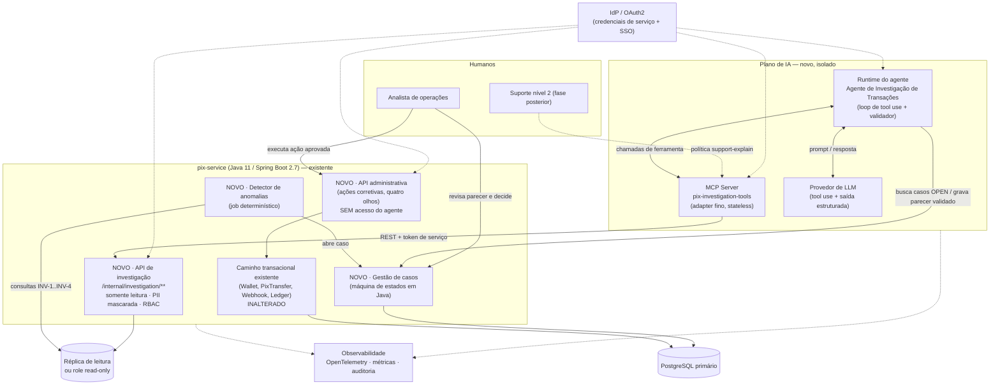
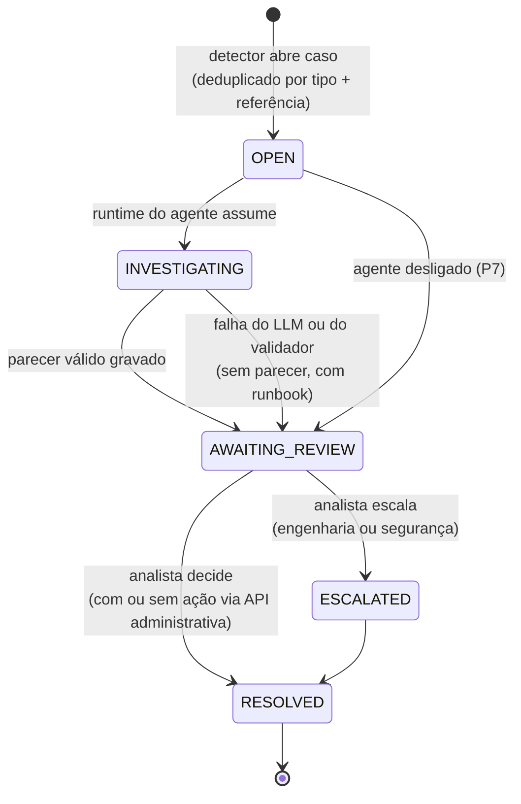
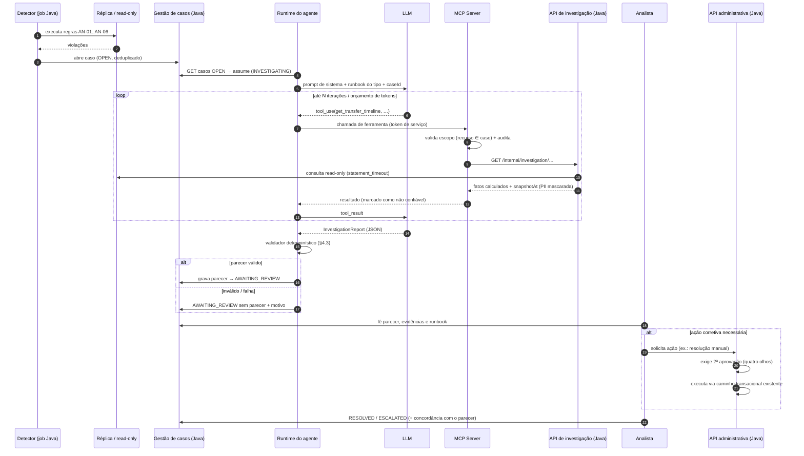
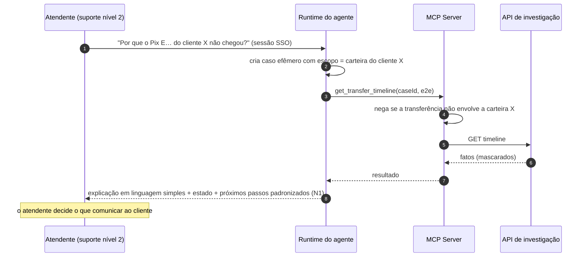
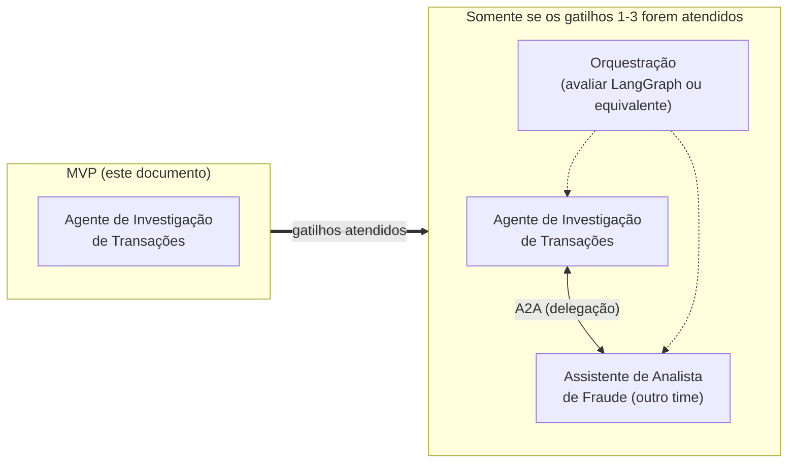

# 04 — Arquitetura Proposta (Agentes de IA)

> **Decisão:** a análise ([03-analise-critica-agentes.md](03-analise-critica-agentes.md)) **não sustenta uma arquitetura multiagente** para o Pix Service hoje. Este documento propõe a **arquitetura mínima viável**:
>
> - **1 agente especialista**, de investigação de transações, somente leitura;
> - **ferramentas determinísticas** implementadas em Java;
> - um **workflow determinístico** de detecção e gestão de casos;
> - **revisão humana obrigatória** antes de qualquer ação.
>
> A evolução para multiagente fica descrita como **condicionada a gatilhos explícitos** (§14).
>
> **Legenda:** **[FATO]** · **[HIPÓTESE]** · **[REF. EXTERNA]** · **[RECOMENDAÇÃO]**. Todo este documento é **[RECOMENDAÇÃO]**, exceto onde marcado.

---

## 1. Princípios de design

| # | Princípio | Consequência prática |
|---|---|---|
| P1 | **O serviço Java é a fonte da verdade** | Toda regra (saldo, transições, reconciliação) é calculada em Java. O agente consome fatos prontos. |
| P2 | **Somente leitura por construção** | Não existe ferramenta de escrita financeira. A proteção não depende do prompt. |
| P3 | **A regra detecta, o agente investiga, o humano decide, o Java executa** | Separação de papéis explícita, com o LLM restrito à etapa de investigação. |
| P4 | **PII mascarada antes do LLM** | O mascaramento acontece na API, e não por instrução ao modelo. |
| P5 | **Assíncrono e fora do caminho transacional** | Nenhuma latência de LLM afeta transferências (E-3). |
| P6 | **Tudo auditável** | Cada chamada de ferramenta e cada parecer ficam registrados com versão de modelo e de prompt. |
| P7 | **Degradação graciosa** | Sem LLM, o caso vai para a fila humana com runbook, e o processo continua. |

---

## 2. Visão geral



**Pontos-chave:**

- **[FATO]** O caminho transacional atual ([TransferPixUseCase.java](../../src/main/java/com/elton/pixservice/usecase/TransferPixUseCase.java), [ProcessWebhookUseCase.java](../../src/main/java/com/elton/pixservice/usecase/ProcessWebhookUseCase.java)) não é tocado pela arquitetura de IA.
- O agente **não tem rota** para a API administrativa nem para o caminho transacional. Só o humano tem.
- O runtime do agente fica **fora** do pix-service, por três motivos:
  - isola as dependências de IA;
  - evita forçar um upgrade para Java 17 ou Spring Boot 3, exigido por frameworks Java de IA atuais [HIPÓTESE / REF. EXTERNA];
  - permite escalar e desligar o agente de forma independente.

---

## 3. Responsabilidades dos componentes

| Componente | Responsabilidade | Não deve fazer | Tecnologia sugerida |
|---|---|---|---|
| **Detector de anomalias** | Executar periodicamente as regras INV-1 a INV-4 e os tipos AN-01 a AN-06 (§4.5) e abrir casos deduplicados | Corrigir dados; chamar o LLM | `@Scheduled` no pix-service, ou worker Java separado com ShedLock para não executar em duplicidade nas 2 réplicas |
| **Gestão de casos** | Manter o ciclo de vida do caso (§4.4), atribuição, parecer e decisão humana | Executar ações financeiras | Módulo Java com tabela `investigation_cases` |
| **API de investigação** | Expor **fatos de domínio já calculados**: linha do tempo, reconciliação, extrato mascarado | Expor SQL genérico; retornar PII em claro; escrever | Controllers Spring em `/internal/investigation/**`, role de banco read-only, `statement_timeout` |
| **API administrativa** | Ações corretivas auditadas: reprocessar, resolver manualmente, estornar com aprovação dupla | Ser acessível pelo agente | Controllers Spring com autorização forte e quatro olhos (**lacuna atual**) |
| **MCP Server** | Publicar as ferramentas com schema, validar o token, aplicar escopo por caso, auditar as chamadas | Ter lógica de negócio; cachear dados sensíveis | Servidor MCP fino (qualquer SDK oficial) |
| **Runtime do agente** | Rodar o loop de tool use com limites, aplicar o prompt e os runbooks, **validar o parecer** (§4.3) e gravá-lo no caso | Decidir ações; reter memória de clientes | Serviço independente com o SDK do provedor de LLM |
| **Provedor de LLM** | Raciocínio e redação | Receber PII em claro | Escolhido na POC por acurácia, custo, latência e contrato (doc 05) |

---

## 4. Contratos

### 4.1 API de investigação (Java, somente leitura)

| Endpoint | Retorna (fatos calculados em Java) | Base no código atual |
|---|---|---|
| `GET /internal/investigation/transfers/{e2e}/timeline` | Transferência, lançamentos ligados, eventos de liquidação (aceitos **e** ignorados), estado atual, `allowedTransitions`, `timeInStateSeconds`, `expectedEntries` vs `actualEntries` | [USEFUL_QUERIES.sql#L209](../../uteis/USEFUL_QUERIES.sql#L209), [TransferStatus.java#L13-L23](../../src/main/java/com/elton/pixservice/domain/valueobject/TransferStatus.java#L13-L23) |
| `GET /internal/investigation/wallets/{id}/reconciliation` | `materializedBalance`, `ledgerBalance`, `difference`, `pendingOutgoingAmount`, contagem de lançamentos | [USEFUL_QUERIES.sql#L68](../../uteis/USEFUL_QUERIES.sql#L68), [LedgerEntry.java#L34-L45](../../src/main/java/com/elton/pixservice/domain/entity/LedgerEntry.java#L34-L45) |
| `GET /internal/investigation/wallets/{id}/ledger?from&to&page` | Lançamentos paginados com metadata **mascarada** | [LedgerEntryJpaRepository.java](../../src/main/java/com/elton/pixservice/infrastructure/persistence/repository/LedgerEntryJpaRepository.java) |
| `GET /internal/investigation/settlement-events?e2e=` | Eventos recebidos, inclusive os ignorados por RN-23 e os rejeitados por "transfer not found" | **Requer persistir** os eventos hoje descartados (AC-06) |
| `GET /internal/investigation/cases/{caseId}` | Tipo de anomalia, regra disparada, referências (E2E, walletIds), `detectedAt` | Novo |
| `GET /internal/investigation/runbooks/{anomalyType}` | Runbook versionado em git (markdown) | Novo |
| `GET /internal/investigation/logs?correlationId&from&to` *(opcional)* | Linhas de log correlacionadas | **Requer** correlation ID e MDC (lacuna, [01 §10.2](01-arquitetura-atual.md#102-observabilidade)) |

**Convenções obrigatórias em toda resposta:**

- `snapshotAt` (timestamp da leitura) e `source` (`replica` ou `primary`).
- Chaves Pix mascaradas (por exemplo, `***.456.789-**`, `j***@d***.com`). O `userId` é tratado como dado não confiável.
- Valores monetários como string decimal, nunca float.
- Campos textuais livres sinalizados como `untrusted: true`.

Exemplo de resposta de linha do tempo:

```json
{
  "snapshotAt": "2026-10-23T14:02:11Z",
  "source": "replica",
  "transfer": {
    "endToEndId": "E3f2a…",
    "fromWalletId": 101, "toWalletId": 202,
    "amount": "150.00", "status": "CONFIRMED",
    "createdAt": "…", "confirmedAt": "…", "rejectedAt": null,
    "timeInStateSeconds": 5400,
    "allowedTransitions": []
  },
  "ledger": {
    "expectedEntries": ["TRANSFER_DEBIT@101", "TRANSFER_CREDIT@202"],
    "actualEntries": [
      {"id": 9001, "walletId": 101, "type": "TRANSFER_DEBIT", "amount": "150.00", "createdAt": "…"},
      {"id": 9010, "walletId": 202, "type": "TRANSFER_CREDIT", "amount": "150.00", "createdAt": "…"}
    ],
    "missingEntries": []
  },
  "settlementEvents": [
    {"eventId": {"value": "evt_1", "untrusted": true}, "type": "CONFIRMED", "outcome": "APPLIED", "receivedAt": "…"},
    {"eventId": {"value": "evt_2", "untrusted": true}, "type": "REJECTED", "outcome": "IGNORED_INVALID_TRANSITION", "receivedAt": "…"}
  ]
}
```

### 4.2 Ferramentas MCP

Todas as ferramentas são **somente leitura** e exigem `caseId`. O servidor MCP valida que o recurso pedido pertence ao caso, o que impede a "pesca" de dados fora do escopo.

| Ferramenta | Entrada | Mapeia para |
|---|---|---|
| `get_case` | `caseId` | `GET /cases/{caseId}` |
| `get_transfer_timeline` | `caseId`, `endToEndId` | `GET /transfers/{e2e}/timeline` |
| `get_wallet_reconciliation` | `caseId`, `walletId` | `GET /wallets/{id}/reconciliation` |
| `list_wallet_ledger` | `caseId`, `walletId`, `from`, `to`, `page` (máx. 50 itens) | `GET /wallets/{id}/ledger` |
| `list_settlement_events` | `caseId`, `endToEndId` | `GET /settlement-events` |
| `get_runbook` | `anomalyType` (enum) | `GET /runbooks/{type}` |
| `search_logs` *(opcional)* | `caseId`, `correlationId`, janela ≤ 1 h | `GET /logs` |

Exemplo de definição:

```json
{
  "name": "get_wallet_reconciliation",
  "description": "Retorna saldo materializado, saldo pelo ledger e a diferença JÁ CALCULADA para uma carteira vinculada ao caso. Não recalcule valores; use 'difference'.",
  "inputSchema": {
    "type": "object",
    "properties": {
      "caseId":   {"type": "string", "pattern": "^CASE-[0-9]+$"},
      "walletId": {"type": "integer", "minimum": 1}
    },
    "required": ["caseId", "walletId"],
    "additionalProperties": false
  }
}
```

**Ferramentas propositalmente ausentes:**

- SQL livre.
- HTTP genérico.
- Qualquer escrita.
- Acesso a dados de carteiras não vinculadas ao caso.

### 4.3 Contrato de saída do agente (parecer)

```json
{
  "$schema": "https://json-schema.org/draft/2020-12/schema",
  "title": "InvestigationReport",
  "type": "object",
  "required": ["caseId", "snapshotAt", "summary", "rootCause", "evidence", "recommendedAction", "requiresHumanApproval"],
  "additionalProperties": false,
  "properties": {
    "caseId": {"type": "string"},
    "snapshotAt": {"type": "string", "format": "date-time"},
    "summary": {"type": "string", "maxLength": 800},
    "rootCause": {
      "type": "object",
      "required": ["category", "hypothesis", "confidence"],
      "properties": {
        "category": {"enum": ["EVENT_ORDERING", "PROVIDER_RETRY", "CONCURRENCY_RACE", "MISSING_SETTLEMENT", "MANUAL_DATA_CHANGE", "CODE_DEFECT", "UNKNOWN"]},
        "hypothesis": {"type": "string", "maxLength": 1200},
        "confidence": {"enum": ["LOW", "MEDIUM", "HIGH"]}
      }
    },
    "evidence": {
      "type": "array", "minItems": 1,
      "items": {
        "type": "object",
        "required": ["claim", "toolCallId"],
        "properties": {
          "claim": {"type": "string"},
          "toolCallId": {"type": "string"},
          "fieldPaths": {"type": "array", "items": {"type": "string"}}
        }
      }
    },
    "financialImpact": {
      "type": "object",
      "properties": {
        "amount": {"type": "string", "pattern": "^[0-9]+\\.[0-9]{2}$"},
        "walletIds": {"type": "array", "items": {"type": "integer"}},
        "toolCallId": {"type": "string"}
      }
    },
    "recommendedAction": {
      "type": "object",
      "required": ["code", "rationale"],
      "properties": {
        "code": {"enum": ["NO_ACTION", "MONITOR", "REQUEST_PROVIDER_STATUS", "MANUAL_REFUND_REVIEW", "MANUAL_CREDIT_REVIEW", "ESCALATE_ENGINEERING", "ESCALATE_SECURITY"]},
        "rationale": {"type": "string"}
      }
    },
    "requiresHumanApproval": {"const": true},
    "openQuestions": {"type": "array", "items": {"type": "string"}}
  }
}
```

**Validador determinístico no runtime.** Ele roda antes de gravar o parecer e, se falhar, o caso vai para a fila humana sem parecer. As regras são:

1. O parecer passa no JSON Schema.
2. Todo `toolCallId` citado existe no transcript do caso.
3. Todo `endToEndId`, `walletId` e valor monetário presente em `summary`, `hypothesis` ou `financialImpact` aparece em algum resultado de ferramenta. Isso bloqueia IDs e valores inventados.
4. `confidence = LOW` força `recommendedAction.code = ESCALATE_*`.
5. `financialImpact.amount`, quando presente, é **igual** a um campo `difference` ou `amount` retornado por ferramenta.

### 4.4 Ciclo de vida do caso (determinístico, em Java)



### 4.5 Catálogo inicial de anomalias (detecção determinística)

| Tipo | Regra de detecção | Origem no código | Mudança determinística necessária |
|---|---|---|---|
| AN-01 `BALANCE_LEDGER_MISMATCH` | `wallets.balance ≠ Σ ledger assinado` (INV-1) | [USEFUL_QUERIES.sql#L68](../../uteis/USEFUL_QUERIES.sql#L68) | Transformar a consulta em job |
| AN-02 `CONSERVATION_VIOLATION` | Viola INV-2 (global) | [02 §5](02-domain-capability-map.md#5-agregados-entidades-e-invariantes) | Job |
| AN-03 `INCOMPLETE_TRANSFER_LEDGER` | Transferência terminal sem o par de lançamentos esperado (INV-3) | RN-20, RN-21 | Job |
| AN-04 `PENDING_TIMEOUT` | `status='PENDING' AND created_at < now() - X` (INV-4) | AC-05 | Job e parâmetro X |
| AN-05 `CONFLICTING_SETTLEMENT_EVENT` | Evento oposto recebido após estado terminal | [ProcessWebhookUseCase.java#L58-L62](../../src/main/java/com/elton/pixservice/usecase/ProcessWebhookUseCase.java#L58-L62) | **Persistir** o evento ignorado com `outcome=IGNORED_INVALID_TRANSITION`, em vez de apenas registrar log |
| AN-06 `SETTLEMENT_FOR_UNKNOWN_TRANSFER` | Webhook para E2E inexistente | [ProcessWebhookUseCase.java#L37-L38](../../src/main/java/com/elton/pixservice/usecase/ProcessWebhookUseCase.java#L37-L38) | **Persistir** a tentativa rejeitada, hoje um 400 sem registro |

---

## 5. Fluxos de sequência

### 5.1 Detecção, investigação, revisão humana e ação determinística



### 5.2 Explicação para o suporte (fase posterior, política `support-explain`)



---

## 6. Comunicação entre agentes: A2A

| Pergunta | Avaliação |
|---|---|
| Há mais de um agente? | **Não.** A proposta tem um único agente (doc 03 §6). |
| Há agentes de outras equipes ou organizações que precisam delegar tarefas com internals opacos? | **Não** no escopo atual. |
| **Decisão** | **Não adotar A2A agora.** O protocolo resolve interoperabilidade entre agentes autônomos; sem um segundo agente, ele só adiciona superfície de ataque e operação. |
| Gatilho para reavaliar | Surgir um agente mantido por outro time, como um assistente da plataforma antifraude, que precise **delegar** uma investigação a este agente ou recebê-la dele (§14). |

## 7. Exposição de ferramentas: MCP

| Prós no contexto deste sistema | Contras |
|---|---|
| Um contrato de ferramentas reutilizável por **mais de um cliente**: o runtime do agente e, na POC, analistas usando um cliente MCP existente, sem construir UI | Mais um componente para operar e proteger |
| Isola credenciais: o runtime não conhece a URL nem o token da API Java | Um salto de rede a mais (irrelevante, porque o fluxo é assíncrono) |
| Ponto único para escopo por caso, auditoria e rate limit das ferramentas | A especificação de autorização do MCP ainda evolui [REF. EXTERNA] e exige validação de segurança própria |
| Descoberta e schema padronizados facilitam a suíte de avaliação | — |

**Decisão:** **adotar MCP como camada fina de ferramentas.** O contrato que importa, porém, é a **API de investigação em Java**. Se o MCP se mostrar um custo desnecessário na POC, o runtime pode chamar a API REST diretamente por function calling sem perda arquitetural. O MCP é substituível; a API não é.

## 8. Orquestração: LangGraph ou alternativa

| Necessidade | Onde fica | Precisa de LangGraph? |
|---|---|---|
| Ciclo de vida do caso (abrir, investigar, revisar, resolver) | **Java** (§4.4): é um workflow de negócio determinístico | Não |
| Loop de raciocínio do agente (chamar ferramentas até concluir) | Runtime: um laço de tool use com limite de iterações | Não. O SDK do provedor basta. |
| Ramificações condicionais, checkpoints e retomada dentro do raciocínio | Não exigido no MVP | — |
| Coordenação de múltiplos agentes | Não existe | — |

**Decisão:** **não adotar LangGraph no MVP.** Um grafo de orquestração de LLM para um único agente com um laço linear adicionaria dependência e complexidade sem benefício. Reavaliar se a investigação exigir sub-etapas com checkpoint e interrupção humana dentro do raciocínio, ou se surgir um segundo agente (§14). Uma alternativa avaliada e descartada para o MVP é implementar o agente dentro do pix-service com um framework Java de IA: isso acoplaria o ciclo de vida do serviço transacional ao do agente e provavelmente exigiria upgrade de plataforma [HIPÓTESE].

---

## 9. Contexto, estado e memória

| Aspecto | Decisão |
|---|---|
| **Contexto de trabalho** | Por caso: prompt de sistema, runbook do tipo de anomalia e resultados de ferramenta. Listas longas chegam já paginadas ou agregadas pela API (por exemplo, a reconciliação retorna `difference`, não 10 mil lançamentos). |
| **Estado** | Fica **no Java** (`investigation_cases`), e não no agente. O agente é stateless entre invocações: se cair, outra instância retoma a partir do caso. |
| **Memória de longo prazo de clientes** | **Nenhuma.** O agente não guarda dados de clientes entre casos. |
| **Conhecimento organizacional** | Runbooks versionados em git, servidos por `get_runbook`. O corpus é pequeno e cabe no contexto, então **não há banco vetorial nem RAG no MVP**. |
| **Aprendizado com casos passados** | Só em fase posterior: casos resolvidos, **anonimizados e curados por humanos**, como exemplos. O agente não escreve na própria base de conhecimento, o que evita envenenamento de memória. |

---

## 10. Autenticação, autorização, auditoria e observabilidade

### 10.1 Identidades e autorização

| Ator | Autenticação | Autorização |
|---|---|---|
| Analista | SSO (OIDC) | Papel `ops-analyst`: lê casos e pareceres; aciona a API administrativa (que exige segunda aprovação) |
| Atendente | SSO (OIDC) | Papel `support-l2`: casos efêmeros com escopo de titular |
| Runtime do agente | Credencial de workload (OAuth2 client credentials) | Escopo `investigation:read` e `cases:write-report`. **Sem** escopo administrativo. |
| MCP Server | Valida audiência e escopo do token | ABAC: o recurso pedido precisa pertencer ao `caseId` |
| API de investigação | Token de serviço do MCP | Role de banco somente leitura; `statement_timeout` |

**[FATO]** Hoje não existe autenticação alguma no pix-service (AC-02). **Implementá-la é pré-requisito** (doc 05, fase 0).

### 10.2 Auditoria

- Tabela append-only `agent_audit_log` com caso, ator, ferramenta, parâmetros, hash da resposta, versão de modelo, versão de prompt, tokens e timestamp.
- **Proteção no banco:** `REVOKE UPDATE, DELETE` e trigger de bloqueio. Isso corrige, para o novo contexto, a lição do AC-13 (o ledger é imutável só por convenção).
- Parecer e decisão humana vinculados, incluindo se o analista **concordou** com o parecer. Essa é a métrica central de qualidade.

### 10.3 Observabilidade

- **Tracing OpenTelemetry por caso:** um span por chamada ao LLM, por ferramenta e por chamada à API.
- **Métricas:** casos abertos e fechados por tipo; tempo até diagnóstico; tokens e custo por caso; taxa de rejeição do validador; taxa de concordância humana; erros de ferramenta; casos degradados.
- **Alertas:** pico de custo, pico de rejeição do validador e indisponibilidade do LLM (degradação ativa).
- **Pré-requisito do sistema atual [FATO]:** não há correlation ID nem MDC ([application.yml#L66-L67](../../src/main/resources/application.yml#L66-L67)), e há PII em logs (AC-07). Isso precisa ser corrigido antes de expor logs a qualquer ferramenta.

---

## 11. Limites transacionais e intervenção humana

| Regra | Implementação |
|---|---|
| O agente **nunca** participa de transação de escrita | Role de banco read-only e réplica; nenhuma ferramenta de escrita |
| Toda ação corretiva passa por humano e pela API administrativa | O agente só recomenda códigos de uma lista fechada (§4.3) |
| Ações financeiras exigem **quatro olhos** | Solicitante ≠ aprovador, ambos humanos |
| A API administrativa reutiliza os casos de uso existentes | Por exemplo, a resolução manual chama a mesma lógica de `processConfirmation` e `processRejection` ([ProcessWebhookUseCase.java#L57-L115](../../src/main/java/com/elton/pixservice/usecase/ProcessWebhookUseCase.java#L57-L115)) com auditoria, sem caminho paralelo |

| Ação | Agente | Analista | 2º aprovador |
|---|---|---|---|
| Investigar e redigir parecer | ✅ | — | — |
| Marcar caso como resolvido sem ação | ❌ | ✅ | — |
| Solicitar status ao provedor | Recomenda | ✅ | — |
| Resolução manual, crédito ou estorno | Recomenda | Solicita | ✅ obrigatório |
| Escalar para segurança | Recomenda | ✅ | — |

---

## 12. Como evitar que o agente reproduza a lógica Java

| Regra | Por quê |
|---|---|
| As ferramentas retornam **fatos de domínio calculados** (`difference`, `allowedTransitions`, `missingEntries`), e não tabelas cruas | Se o LLM precisasse somar lançamentos ou inferir transições, reimplementaria RN-19, RN-26 e RN-27 de forma não testada |
| **Não há ferramenta de SQL livre** | SQL gerado por LLM duplicaria e divergiria das fórmulas oficiais |
| Fórmulas de reconciliação ficam em Java, com testes unitários | Há uma única implementação, testada |
| Nova necessidade de cálculo leva a **novo endpoint**, não a nova instrução no prompt | Mantém a regra no código versionado |
| Testes de contrato entre a API e os schemas MCP | Evitam divergência silenciosa |
| O validador rejeita valores que não vieram de ferramenta | Bloqueia "aritmética do LLM" |
| Os runbooks descrevem **como interpretar** os fatos, e não como calculá-los | A separação entre narrativa e regra fica explícita |

---

## 13. Comparação com alternativas

| Critério | **A.** Só determinístico (jobs, dashboards, runbooks) | **B.** Agente único + ferramentas (**proposta**) | **C.** Multiagente (agente por domínio + orquestrador, A2A, LangGraph) | **D.** Chat genérico com SQL direto no banco |
|---|---|---|---|---|
| Resolve a detecção | ✅ | ✅ (via A) | ✅ (via A) | ⚠️ ad hoc |
| Acelera a investigação de causa raiz | ❌ (manual) | ✅ (hipótese a validar) | ✅ (mesma, a um custo maior) | ⚠️ sem garantias |
| Complexidade | Baixa | Média | **Alta** | Baixa para construir, alta para controlar |
| Custo de execução | Mínimo | Tokens por caso (limitado) | Múltiplas chamadas de LLM por caso | Imprevisível |
| Latência | Segundos | Dezenas de segundos (assíncrono) | Minutos | Variável |
| Risco de segurança | Baixo | Baixo/médio (somente leitura, escopo por caso) | Médio/alto (mais superfície) | **Inaceitável**: PII, sem escopo, SQL arbitrário |
| Auditabilidade | Alta | Alta (validador e log) | Média (cadeias entre agentes) | Baixa |
| Reprodução de lógica Java | Nenhuma | Evitada por design (§12) | Alta tendência | **Total** |
| Reversibilidade | — | Alta (o agente pode ser desligado; A continua) | Baixa | — |
| **Veredito** | **Obrigatório** (fase 0) | **Recomendado para POC** sobre A | **Não justificado** | **Rejeitado** |

**Conclusão:** **A é pré-requisito, B é a hipótese a validar, C só se justifica com os gatilhos da §14 e D é um anti-padrão.**

---

## 14. Evolução condicionada para multiagente

Esta seção só se aplica se **todos** os gatilhos abaixo forem atendidos:

1. O agente da fase B demonstrou valor na POC e em shadow mode (critérios no doc 05).
2. Surgiu uma **segunda capacidade de IA** com ferramentas, dados, modelo de risco e **dono distintos**, por exemplo um assistente de analista de fraude sobre um motor de risco, que hoje não existe (doc 03 §2.5).
3. Existe um caso real de **delegação entre agentes**: um investigando fraude precisa de uma linha do tempo de liquidação produzida pelo outro.



Mesmo nesse cenário, o orquestrador seria **determinístico** sempre que o roteamento puder ser decidido pelo tipo do caso. Um orquestrador LLM só se justificaria se o roteamento exigir interpretação.
